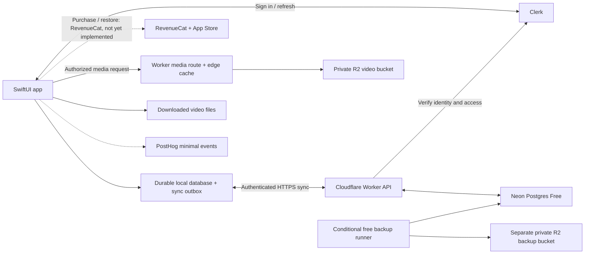

# System design

Status: design proposal implementing accepted requirements, partly implemented. Runtime behavior and provider costs must be verified with chosen SDK versions and current pricing before each part ships. The API Worker and catalog dashboard are deployed to the development environment ([Worker setup](../worker/README.md), [dashboard guide](../admin/README.md)); production deployment and App Store release have not happened. Sections below note which parts are not yet implemented.

## Components

Postgres stores content references and logs; it does not fetch video bytes or send them to a CDN. Workout input flows through durable device storage. Media has a separate path so streaming never occupies a database connection.

## iOS application

SwiftUI owns presentation. Local storage is split across three account-scoped stores composed in [AppDependencies](../OneSet/App/AppDependencies.swift): a file-backed cache of the last downloaded catalog; a JSON [onboarding progress document](../OneSet/Persistence/FileOnboardingProgressStore.swift) holding completed setup, cycle state and their pending uploads; and a GRDB SQLite [workout repository](../OneSet/Persistence/WorkoutRepository.swift) holding sessions and drafts, rest deadlines, the completed-session upload queue, History pages and coverage, restored progress and previous-performance summaries, and remembered replacements. GRDB migrations version the workout store. The cached entitlement record specified in the [RevenueCat integration](revenuecat-integration.md) is not yet implemented.

Suggested modules: account/access, catalog, active workout, history, sync, media downloads. Active workout depends on local repositories and injected time, not directly on Clerk/payment services/network. Analytics is asynchronous and never a prerequisite for save/finish.

Writes serialize through a local transaction. Only after commit does UI confirm the save and schedule rest. A local storage failure displays an actionable failure and retains visible input; optimistic success alone is insufficient. Draft text input is currently coalesced and saved after one second of inactivity, and explicit actions and app lifecycle changes flush it sooner; measure write latency rather than lengthening that debounce.

After identity restoration, app startup opens safe account-scoped setup and compact progress from this device and restores an active session. It refreshes the catalog and account progress in the background; when local progress is unsafe or missing it waits for remote restoration with timed recovery. A detected remote program change stays staged until the user selects Update, and blocks new session starts while preserving an active session. Store that summary by account and cycle, independently from downloaded History sessions; combine its completion marks with local finished sessions when choosing the next occurrence. User data is namespaced per account; never render one user's store to another. Sign-out with pending completed sessions or a queued program change keeps that work and its upload queue on the device, explains that it resumes when the same account signs in again, and also keeps any pending setup it depends on. Never silently clear the outbox.

History stores complete finished sessions and owner-scoped keyset coverage separately from compact progress and previous-performance summaries. On tab return, foreground, or pull-to-refresh, request the newest page and merge by stable session ID; fetch older pages only when the user asks to continue. Persist each page and its cursor atomically. Keep local pending finishes and upload bookkeeping intact, preserve the visible session anchor and detail route when rows merge, and reject requests overtaken by refresh or account changes. Page omissions never imply deletion.

## Worker API and Postgres

One modest Worker service with routes for catalog, owned training state, sync and media is sufficient. Verify Clerk tokens and derive user ownership at the boundary; no client-provided `user_id` authorizes access. Use a restricted database role, parameterized queries and an authenticated server-side Postgres connection. Atomic writes run as single Postgres functions (for example `save_completed_session` in [migration 006](database/migrations/006_completed_session_write.sql)) called through the Neon HTTP driver, so each command is one transaction rather than unrelated statements.

The database has 14 tables: the original ten, completion marks, catalog publications and catalog state, and per-cycle workout periods (see the [DBML](database/oneset.dbml)). Resolve session ownership through its program run; only sessions carry a revision column, reserved for the proposed update protocol. Timers are local. Template entries with null position are omitted from future workouts while their IDs remain valid for history. See the [database design](database/README.md) and [API contracts](api-contracts.md).

Neon Free initially. Use pooling/serverless connection behavior appropriate to Workers and avoid idle keepalive queries. Put writable user data only in Postgres; no public edge caching of history. Current catalog responses can use ETags for cache revalidation. No separate read replica, queue service or distributed lock platform is required initially.

Free CPU/request/storage limits must be measured with token verification, transactions and media authorization included. If the selected tier cannot meet the design, surface the cost/behavior tradeoff; a paid upgrade is not preauthorized merely by this document.

## Authentication and subscription

Account enrollment links a unique Clerk subject to OneSet user ID. The approved account choices on Welcome are Apple, Google, and email for both new and returning users. Email authentication uses a verification code. All Continue with actions resolve existing account state before routing and preserve completed setup. Unfinished onboarding choices save locally on Continue and are not synced across devices. After authentication, onboarding can continue offline using the bundled catalog; subscription enrollment requires connectivity. Clerk session expiration is internal: active training continues locally; failed refresh prompts reauthentication after local finish. API rejects invalid tokens while local state remains intact.

Completed onboarding saves units, training frequency, and selected program to the backend on entering program overview after accepting or dismissing the trial offer. Offline completion persists locally and allows overview access; upload completed setup when connectivity returns. Intermediate steps remain local only. Cross-device restoration requires a successful completed-setup upload. The save tolerates retries without duplicating enrollment or cycles; see the implemented [completed setup save](account-setup.md#completed-setup-save).

Unfinished onboarding progress survives app closure while signed in, but is cleared on sign-out. Local setup belongs to the authenticated account and must never be exposed to another account. Email entry and code verification use OneSet's existing visual styles, with change-email, resend-code, and invalid/expired-code handling.

If account setup lookup fails after authentication, continue from saved local state for that account when available; otherwise show retry rather than treating the account as new. Signing out with completed setup awaiting upload requires an explicit cancel-or-discard confirmation. Confirmed sign-out discards that local setup and its pending upload unless queued completed workouts or a queued program change depend on it; then the setup stays with that work. See [account setup](account-setup.md).

Clerk owns account profiles and access; Postgres keeps only the Clerk user ID link plus training-specific preferences. Read name/email from Clerk instead of maintaining local copies. Server requests use trusted Clerk identity/access checks. OneSet preferences and active-program choices use the latest values saved to the server; no user revision or settings conflict flow is needed.

Clerk authenticates the OneSet account. The Worker resolves account setup, and RevenueCat provides verified subscription access for the app. The app uses the last verified expiry to decide whether it can create a new local workout session, including while offline. Subscription expiry is separate from sign-in expiry. See the [RevenueCat integration](revenuecat-integration.md).

The Worker independently verifies access for protected media requests and for any future endpoint that authorizes a protected workout start. A completed session can sync after the subscription expires. Apply the existing account and data checks to that upload under FR-23. A client-supplied session timestamp cannot establish current Pro access.

History, profile, subscription management, and previews remain available without payment. Trials begin with successful enrollment in the store offer. Show Apple's actual localized price and eligibility for the seven-day trial. Target U.S. prices are $4.89/month and $49.99/year.

## Protected video delivery

Not yet implemented: the app shows a video placeholder and the Worker has no media routes.

- Import immutable compressed video objects to private R2; keep `r2.dev`/public access disabled. Catalog exposes an immutable object key as the media identifier, without access credentials.
- App asks Worker for an authorized stream/download or short-lived media grant. Worker validates caller/access before any cached response. Gate full instructional media to active entitlement as a **design assumption**; unpaid program previews expose names/text, not necessarily video.
- Cache the common immutable bytes by media version, not by a user bearer token. Authorization still runs on every protected request; never allow an edge cache hit to bypass it. Grant validation, cache location and range behavior require a dedicated integration check.
- Support HTTP byte ranges, content type/length, cancellation and seek behavior. Cache partial responses only with a correct range-aware design. Do not use arbitrary token query strings in logs/analytics.
- Download only when a workout is explicitly opened on Wi-Fi; deduplicate already verified files by checksum/video key. Proposed policy: stop automatic downloads if connection becomes cellular, while user-initiated streaming remains allowed.
- Save into temporary files, verify checksum/length, then atomically rename. An interrupted download is never marked ready. Use bounded concurrency. Proposed local cache budget: 500 MB, evict least-recently-used clips outside the active workout; make unavailable clips clear if OS evicts storage.
- Downloaded clips remain usable offline. Revoking an online grant does not remotely remove already copied bytes; no DRM claim. Proposed expiry behavior: no fresh downloads after entitlement expiry; history retains text/instructions.

R2 caching mechanics depend on a custom domain/Worker route. See [official cache guidance](https://developers.cloudflare.com/cache/interaction-cloudflare-products/r2/) and [Worker Cache API example](https://developers.cloudflare.com/r2/examples/cache-api/). These sources establish available mechanisms, not a tested private-media implementation.

## Security and operational boundaries

TLS, verified account ownership, short-lived media access, private backups, limited storage/database credentials, and environment-separated secrets are required design controls. Personal training values stay out of logs and analytics. Error telemetry contains codes and aggregate IDs only where necessary, never request bodies or tokens.

Account deletion is a release requirement to specify and verify against distribution requirements; Settings currently shows a placeholder and the Worker has no erasure route. Proposed flow requires online reauthentication, erases owned server data and local state, disables identity/access, and records a minimal erasure instruction so disaster restore cannot resurrect the account. Explain that deleting an account and canceling a store subscription are separate actions. Retained encrypted operational backups age out; exact privacy wording requires review.

## Minimal analytics

Not yet implemented: the app has no PostHog dependency or event adapter.

| Event | Allowed properties |
| --- | --- |
| onboarding_completed | app version, selected unit, frequency |
| program_selected | catalog program IDs |
| trial_converted | product ID, conversion kind; authoritative deduplication |
| workout_started / workout_completed | program ID, app version, offline flag; no measured performance |
| sync_failed | stable error category, retryable flag, app version |

Use pseudonymous account identity where needed, no email/name/notes. Disable unnecessary autocapture and replay. Keep analytics/event volume controls inside the free allowance. Operational alerts must detect backup staleness as well as failure events; a missing job does not emit its own failure. The conditional backup runner in the component diagram is not yet implemented.

## Catalog publication

The founder's [program library](HIT_Workout_Program_Library.md) is the source for the gym-only programs: the original ten plus HIT Upper / Lower Rotation. Convert it into a reviewed structured catalog with stable program, workout and exercise-slot IDs. Every exercise uses one working set with weight and reps. Keep shared instructions, stopping guidance, warmup guidance, rest duration and video key on the exercise; workout slots hold their rep ranges. Frequency is the number of current workouts scheduled in one training week; for alternating odd/even programs it counts one week's variant, not both.

Before import, verify program names, frequency, order, rep bounds, warmup exceptions, replacement guidance and video coverage. Preserve IDs across compatible edits. A removed template entry gets a null position so historical sessions and offline snapshots can still refer to it; never reuse its ID for another movement. Produce a readable catalog diff, validate in a disposable environment, and commit the complete catalog change in one transaction. Started sessions keep their copied content; future sessions use the new template.

Prepare short mobile-friendly videos, record checksums and MIME types, and upload immutable objects to private R2 keys. Verify playback and range requests through the authorized Worker before making a video selectable. Keep source masters separately. Publication credentials must be distinct from ordinary user API access. A separate, laptop-first web dashboard hosted on Cloudflare and restricted to the founder covers the existing text-catalog workflow; it is implemented in [`admin/`](../admin/README.md). Edit, review, and publish during one visit without saved drafts or autosave. Cloudflare Access restricts entry to the founder's exact email through email-code login, with sessions configured for up to one month on the Free plan. After each publication the dashboard commits the retained source YAML and regenerated bundled fallback to the repository. Video upload remains deferred for that dashboard. See [the dashboard boundary decision](adr/0002-separate-catalog-dashboard.md).

### Accepted dashboard stack

The founder accepted this stack, and the dashboard in `admin/` implements it:

| Responsibility | Choice |
| --- | --- |
| Pages and server rendering | Astro with TypeScript, using server rendering and the official Cloudflare adapter |
| Hosting | A dedicated Cloudflare Worker for the dashboard, in an `admin/` directory in the same repository as the existing API |
| Editing and submission | Native HTML forms and Astro Actions; small browser scripts for adding and reordering rows where helpful |
| Styling | Plain CSS |
| Administrator access | Cloudflare Access, with server verification of the Access token for privileged requests |
| Catalog validation and publication | Reuse the existing Worker publisher and its validation, change previews, stale-preview checks, and atomic publication |
| Data | Existing Neon catalog and publication records; no separate dashboard database or saved drafts |

Astro supports server-rendered pages on Cloudflare and form submissions to server actions without a client application framework. Browser interactions do not require a single-page application. Keep maintenance credentials in server secrets and keep existing Clerk authentication for the iOS API. After publication, the dashboard serializes the exact retained source to YAML, regenerates `BundledProgramCatalog.swift`, and commits both to the configured branch ([repository sync](../admin/src/repository-sync.ts)). If that export fails, the database publication stays live with a retryable repository status. Publication and repository writes are enabled only in the development catalog environment.

References: [Cloudflare adapter](https://docs.astro.build/en/guides/integrations-guide/cloudflare/), [HTML form actions](https://docs.astro.build/en/guides/actions/#call-actions-from-an-html-form-action).
